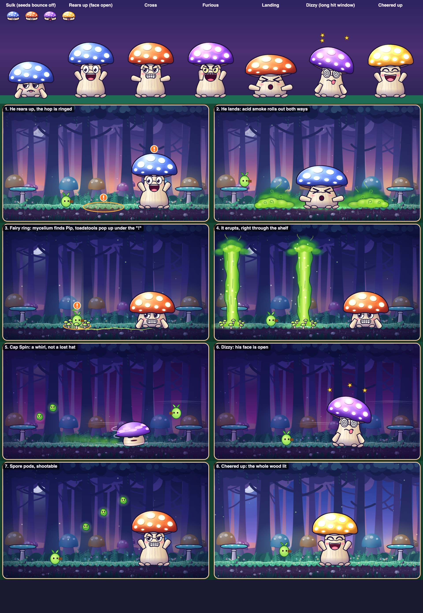

# Mo's fight: art and attack spec (Chapter 2, PR 5)

**For:** the engineer building PR 5. **From:** head of product and design, 2 November 2026. **Status:** waiting for
Farul's approval of the Fairy Ring (section 6.2) and the reference art.

This replaces the "PR 5: Mo's look" section of `docs/chapter-2-plan.md`. Everything else in that plan still stands.
Where the two disagree, this document wins.

**Reference art:** [`docs/mo-art/reference.jpg`](mo-art/reference.jpg) is what we are aiming at.
[`docs/mo-art/reference.html`](mo-art/reference.html) draws the same picture from code: open it in a browser, and tune
it there if you like. Its functions are Canvas 2D, in world units, around (0, 0), so they go inside a `bake()` nearly
as they are.



## 1. Why

Farul played PR 4 and said:

> "many graphics and design need to be improved... lets improve it so it have production level graphics. I personally
> can accept the stage 2... but the boss one is many things is can be improved, especially the attack from the boss,
> which like a cloud and put a rain, its really bad and the like gray circle attacking horizontally when boss is
> landing is also bad, as its mushroom maybe put like a green acid like smoke which spread horizontally, then the
> cloud and the rain one, i have no idea for now"

What I found when I looked at the fight, all placeholders from PR 4:

| Problem | Where |
| --- | --- |
| Mo is a straight column with a tiny face, and his colours match the background mushrooms | `MoView.ts`, `wood/moArt.ts` |
| The landing attack is a row of grey circles | `ShockwaveView`, `drawWave` |
| The rain cloud is generic, has nothing to do with a mushroom, and its rain is a few thin lines | `GloomView`, `drawCloud`, `drawRain` |
| In Cap Spin, only the cap slides along, like a lost hat | `MoView.sync` |
| The shelf is drawn in front of Mo when he stands near it | `HollowGround`, `depth.platforms` |
| The HUD shows Sunny's portrait, on both the boss bar and Stage 2's path bar | `WOOD.portrait` |
| He plays Sunny's tune | `WOOD.tunes.boss` |

**The goal:** Mo is as memorable as Sunny, and every attack could only come from a mushroom. **The design and rules
from PR 4 stay.** Farul's complaints are about the look, so timings stay as they are, apart from the small hitbox
changes in section 3.

## 2. Scope

| In | Out |
| --- | --- |
| Mo's art, rig, faces and acting | New attacks or phases |
| Acid Smoke (replaces Shockwave's look) | Attack timing changes |
| Fairy Ring (replaces Gloom Cloud) | Next chapter and the +1 life (PR 6) |
| Spore pods, Caplings' arrival, Cap Spin's look | Rain anywhere: the plan's "small rain cloud over him" and "raining" in phase 2 are dropped |
| The hollow: shelf depth, mist, the ending | New Stage 2 layout or balance |
| HUD portrait, bar colours, burst colours | Sunny or the Garden Path: both stay identical to `main` |
| Mo's three tunes and new sounds | Phone layout (#14) |
| Two small Stage 2 fixes (section 9) | |

## 3. Changes to the simulation

Keep these few, and do them first, because they need bot runs.

### 3.1 Renames

The names should say what the player sees. These are renames only: the first commit must replay identically (section
12).

| Now | New | File |
| --- | --- | --- |
| `Shockwave`, kind `'shockwave'` | `AcidSmoke`, kind `'smoke'` | `src/sim/hazards.ts`, `HazardViews.ts` |
| `WAVE_WARN`, `WAVE_SPEED`, `WAVE_AT` | `SMOKE_WARN`, `SMOKE_SPEED`, `SMOKE_AT` | `hazards.ts`, `bosses/mo.ts` |
| `GloomCloud`, kind `'gloom'` | `FairyRing`, kind `'ring'` | `hazards.ts`, `HazardViews.ts` |
| `GLOOM_FOLLOW`, `GLOOM_WARN`, `GLOOM_RAIN` | `RING_SEEK`, `RING_WARN`, `RING_ERUPT` | `hazards.ts`, `bosses/mo.ts` |
| `FairyRing.state`: `follow`, `warn`, `rain` | `seek`, `warn`, `erupt` | `hazards.ts` |
| Attack `gloomCloud` | `fairyRing` | `bosses/mo.ts`, `tests/sim/mo.test.ts` |
| Text in test names and comments: "rain", "cloud", "shockwave" | The new words | `tests/sim/mo.test.ts`, `burr.ts` comment |

**Don't rename the weather mood `gloom`.** It is a different thing: see `weather.ts`, `sky.ts`, `woodTheme.ts`,
`chapterViews.ts` and `tests/weather.test.ts`. The Hazard union in `hazards.ts` is the only place the two meet.

**Keep `RING_SEEK` 1.5, `RING_WARN` 0.8 and `RING_ERUPT` 1.1 exactly.** The balance is very sensitive to the warning
time. In PR 4's measurements, the 0.6 s bot won 0% at 0.75 s, 13% at 0.8 s and 62% at 0.9 s.

### 3.2 Shapes, to match the art

A rule for the whole fight: **if it looks solid, it hurts.**

| Constant | Now | New | Why |
| --- | --- | --- | --- |
| `CAP_RX` | 82 | 94 | The cap's art is about 104 wide each way, so seeds and bounces now land close to its edge |
| `STALK_HALF` | 36 | 46 | The stalk's art is 43–60 wide each way |
| `FACE_HIGH` | 122 | 115 | The face stays clear of the brim as he rears up |
| `AcidSmoke.w`, `.h` | 36, 26 | 80, 40 | Keep the inset, so the hit rect is 72 × 36, the smoke's solid body |

Leave these alone:

- **`CAP_RY` and `CAP_LOW`:** Pip's held jump reaches about 152 px, and the sulking cap's top is at 128. Raising it
  would stop him getting over Mo, which is what stops him being pinned. So the art's dome rises about 15 px above where
  he lands, and sinks as he bounces (section 5.5).
- **`SPIN_R`:** Cap Spin's art is scaled to fit (section 6.6).
- **`FairyRing`'s shape:** 58 wide, from y 110 to the ground. The art matches it.

### 3.3 One new event

`thud` is shared with Burr and Dropcap, and Mo's landing needs far more weight than theirs. Add
`{ type: 'bossLand'; x; y }` to `events.ts`, emit it where `Mo.land()` and the end of `capSpin()` emit `thud` today, and
give it a case in `present()` (section 6.1). Leave `thud` as it is for the small enemies.

### 3.4 Re-measure

The bot targets from the plan still apply, and the figures go in the PR body, including any miss.

| Check | Target | PR 4's figure |
| --- | --- | --- |
| Dodging bot, 0.25 s reactions | At least 60% wins | 100% |
| Dodging bot, 0.6 s reactions | 10–20% wins | 13% |
| Each attack alone, 0.15 s bot | No hits | 0.00 |
| Any fixed spot, hold shoot, hop at "!" (repo test) | Under 5% | Under 5% |

If the 0.6 s bot drops below 10%, shrink `AcidSmoke.w` to 64 first, then `STALK_HALF` to 42. Bot runs take a while, so
use the recipe in the `sim-bot-analysis-workflow` memory note.

## 4. Rules for the look

Check every frame against these, along with the README's "How it looks".

1. **Mo is the boldest thing on screen.** He has the thickest outline and the strongest colour, and nothing else in
   the arena is near his size or brightness.
2. **One danger language:**
   - **Orange** means a warning: the "!" and the rings. It never hurts.
   - **Acid green** is Mo's poison, and nothing harmless is this colour except its own fading haze.
   - **Solid with a dark rim hurts. Soft and see-through never does.**
3. **Smoke is layered and soft.** Don't stack hard-edged circles with dark outlines. I tried that, and it looks like a
   hedge or a caterpillar. The curl marks are what say "smoke".
4. **Everything big has anticipation, action and settle.** Nothing starts or stops dead.
5. **One light:** the moon, upper left. Rim light on the upper left of the cap, cool shadow low on the right.
6. **No decoration just to fill a surface.** Farul looks closely, and asked for two fungi on a trunk to be removed in
   PR 3.
7. **A soft glow must fit inside its part's box,** or it shows a square edge.

Engine rules from the README still apply: nothing drawn as `Graphics` per frame, bent shapes through `Ribbon`, and
light (`BlendModes.ADD`) on a depth of its own so it doesn't split batches.

### Palette

Copy these into a `MO_PALETTE` in `src/game/views/mo/art.ts`. `reference.html` has them under the same names.

| Name | Light to dark |
| --- | --- |
| Ink (outlines) | `#1c1238`, the same as the wood's |
| Stalk | `#fff6e2`, `#f3dfbe`, `#d9bb9b`, `#a9849a`, `#6f5288` |
| Cap, sulky (phase 1) | `#d8e6ff`, `#8fb0ff`, `#5476ee`, `#2f3eae`, `#1d2272`; spots `#eef5ff`; glow `#9ec8ff` |
| Cap, cross (phase 2) | `#ffe6c4`, `#ffa766`, `#f4652f`, `#b52f1f`, `#651420`; spots `#fff2dc`; glow `#ffb070` |
| Cap, furious (phase 3) | `#f8dcff`, `#cf95ff`, `#9c4ef2`, `#5a22b0`, `#2b0d66`; spots `#ffd8ff`; glow `#ff84f0` |
| Cap, happy (cheered up) | `#fffcdc`, `#ffe476`, `#ffc53f`, `#e98a2b`, `#94451a`; spots `#fffaea`; glow `#fff0a0` |
| Gills | `#3a2150`, `#6e4668`, `#94687a` |
| Acid gas (`GAS`) | back `#1c6a4a`, mid `#3f9a3c`, body `#8fd832`, hot `#e6fb86`, rim `#14502e` |

Set `barColors` in `WOOD` to the three caps' middle colours: `0x5476ee`, `0xf4652f`, `0x9c4ef2`.

## 5. Mo

### 5.1 Who he is

Sunny is a grump who blooms. **Mo is a sulking kid in a hood.** At rest he pulls his cap down, lets his arms hang,
pouts, and watches Pip sideways from under the brim. Then he erupts. Almost all of his personality comes from the
contrast between the sulk and the outburst, so the two poses should look very different.

### 5.2 Files

Move Mo out of the placeholders, as the plan says:

| File | What goes there |
| --- | --- |
| `src/game/views/mo/art.ts` | Parts and palette. Replaces `wood/moArt.ts` |
| `src/game/views/mo/face.ts` | His faces, as `sunny/face.ts` is for Sunny |
| `src/game/views/mo/smoke.ts`, `ring.ts` | The art for the two new attacks |
| `src/game/views/MoView.ts` | The rig and acting. Rewritten |
| `src/game/views/HazardViews.ts` | `SmokeView` and `RingView` replace the placeholders, or import them from `mo/` |

Bake everything through `bakeMo`, inside `bakeWood`, so it stays in the late-baked `wood` group. The one exception is
the portrait (section 8).

### 5.3 Parts

Sizes are logical pixels; `bake()` multiplies them by `RES`. Pivot means `(ax, ay)`. Treat these as starting values and
check each part with its full art inside the box.

| Key | Size | Pivot | From `reference.html` | Notes |
| --- | --- | --- | --- | --- |
| `mo-cap-0`..`3` | 224 × 124 | 112, 72 | `drawCap` | Sulky, cross, furious, happy |
| `mo-cap-glow-0`..`3` | 250 × 140 | 125, 80 | `drawCapGlow` | `SOFT`, drawn as light, pulses |
| `mo-gills` | 200 × 66 | 100, 8 | `drawGills` | Behind the stalk |
| `mo-foot` | 160 × 76 | 80, 66 | Lower part of `drawStalk` | Bulb and root toes; never stretches |
| `mo-stalk` | 256 × 96 | 0, 48 | Upper part of `drawStalk` | A strip for `Ribbon`, as `sunny-stem` is: shading runs across its height |
| `mo-skirt` | 110 × 46 | 55, 12 | `drawSkirt` | The frilly collar |
| `mo-arm` | 62 × 34 | 4, 17 | `drawArm` | Flipped for the other side |
| `mo-eye` | 36 × 44 | 18, 22 | `eye` (white only) | The two eyes in one image at ±22 is also fine |
| `mo-pupil` | 24 × 30 | 12, 15 | `eye` (pupil only) | Two images that follow Pip |
| `mo-face-<mood>` | 104 × 110 | 52, 44 | `drawFace` less the eye white and pupil | Lids, brows, mouth and blush, over the pupils |
| `mo-whirl-0`..`5` | 210 × 140 | 105, 130 | `drawWhirl` | Flip-book, section 6.6 |
| `mo-whirl-arc` | 240 × 44 | 120, 22 | `drawWhirlArcs` | `SOFT`, drawn as light |
| `mo-pool` | 240 × 40 | 120, 20 | a `glow` | `SOFT`; the mood's colour on the ground under him |
| `mo-shadow` | 200 × 30 | 100, 15 | a `glow` in ink | Grows as he comes down from a hop |

`<mood>` is: `sulk`, `shout`, `cross`, `furious`, `ouch`, `dizzy`, `joy`, `sleepy`. For `ouch`, `dizzy`, `joy` and
`sleepy` the eyes are drawn into the face part, so hide `mo-eye` and `mo-pupil`.

### 5.4 Rig

Back to front, at depths just above `DEPTH.boss`: `mo-pool` and `mo-shadow` (a little below `boss`), `mo-gills`,
`mo-stalk` ribbon, `mo-foot`, `mo-skirt`, arms, `mo-eye`, `mo-pupil`, `mo-face`, `mo-cap`, `mo-cap-glow`.

Each frame, work out his shape from the sim, as `drawMo` in `reference.html` does. `sq` is the squash spring below:

```ts
const capH = lerp(CAP_LOW, CAP_HIGH, rear) * (1 - sq * 0.75);
const faceH = capH - lerp(46, 63, rear); // always this far under the brim, so his eyes peek out as he sulks
```

Everything is measured up from `feet`. The face moves against the hitbox while he sulks, on purpose: the face only
counts as a target when `faceOpen`, once `rear > 0.5`.

**Stalk:** a `Ribbon` of about 10 points from `(x, feet - 30)` to `(x + lean, feet - capH + 6)`, curved by the lean as
Sunny's stem is. `lean` follows his speed and tilt.

**Arms** are at `feet - max(30, faceH - 44)`, 44 out from the middle. Angles for one side, mirrored for the other:

| Pose | Angle | When |
| --- | --- | --- |
| `droop` | 1.05 | Sulking, dizzy |
| `up` | -1.0 | Rearing up, phase 1; cheered up |
| `out` | -0.25 | Landing, phase 2 rearing |
| `flail` | -1.35 ±0.25 | In the air, phase 3 rearing |

Don't fold the arms. I tried it, and they read as a box.

### 5.5 Poses and faces

The sim's fields decide the face. Check these top to bottom and take the first that matches:

| When | Face | Arms | Notes |
| --- | --- | --- | --- |
| `!alive` | `joy` | `up` | Cap 3, section 5.7 |
| `b.state === 'intro'`, `introT < 0.9` | `sleepy` | `droop` | Slow breathing |
| `b.state === 'intro'`, `introT >= 0.9` | `shout` | `up` | The roar. Show him reared up, for the view only |
| `dizzy > 0` | `dizzy` | `droop` | Section 6.6 |
| `flash > 0` and `faceOpen` | `ouch` | Unchanged | Only face shots make him flinch this hard |
| Just landed (0.25 s) | `ouch` | `out` | |
| `open` or `airborne` | Phase's: `shout`, `cross`, `furious` | `up`, `out`, `flail` | |
| Otherwise | Phase's: `sulk`, `cross`, `cross` | `droop` | The sulk |

**Eyes:** `look = clamp((p.x - x) / 200, -1, 1)`; pupils move `look * 5` across and 2 down. Blink every 2.2–5 s with a
`sulk` or `sleepy` lid for 0.12 s, as `SunnyView` does.

**Cap tilt:** `sin(t * 1.5) * 0.015` at rest, ±0.12 when dizzy (centred on 0.2), plus the hit spring below.

### 5.6 Acting

These are numbers to start from. Tune them by watching.

| Moment | What happens |
| --- | --- |
| **Squash spring** | `sqV += (-sq * 320 - sqV * 18) * dt; sq += sqV * dt`. Positive squashes, negative stretches. Stalk and cap widen by `1 + sq * 0.42` |
| **Idle** | Breathing: stalk height ±1.2% at 1.6 rad/s. Spots pulse: `0.5 + sin(t * 1.6) * 0.15` in phase 1, 0.8–1 in phase 3 |
| **Sulk sigh** | Every 4–6 s while sulking: cap sinks 4 px and rises, with a small lilac `puff` from his mouth. Phase 1 only |
| **Crouch before a hop** | Over the last 0.18 s of `telegraph` during `bigHop`: `sq` goes to 0.22 |
| **Take-off** | `sqV = -7`, a stretch |
| **In the air** | The cap lags: `capLag += (vy * 0.018 - capLag) * min(1, dt * 12)`, added to the cap's height. Arms `flail`. Work out `vy` from `y - py` |
| **Landing** | `sqV = 9`, about 0.3 of squash, overshooting as it settles. Effects in section 6.1 |
| **Bounce on his cap** | Use `b.spring.sprung`: add `sin(sprung * PI) * 0.2` to `sq`, and the cap jiggles |
| **Hit** | As `SunnyView`'s `kick`: when `flash` rises, `kickV += 120` away from Pip; spring `(-kick * 260 - kickV * 16)`. Moves the cap fully and the stalk's top by half |
| **Rage** (phase change) | `rage` 1 → 0 over 1.3 s: tremble ±3 px. Cap cross-fades to its new colour over 0.5 s, which needs two cap images |
| **Furious idle** | Tremble ±0.6 px, as Sunny's phase 3 |

### 5.7 Phase changes and the ending

- **Phase change:** `present()` bursts `chapter.shed` as petals, which is wrong for a mushroom. Add
  `shedShape: ParticleShape` to `Chapter` (Sunny's `'petal'`, Mo's a new `'spot'`: a pale oval), and fling his old cap's
  spots off him. Colours stay `shed`.
- **Cheered up:** `bossDefeated` also uses Sunny's colours. Add `cheeredColors` to `Chapter`, with Mo's as golds, pale
  pinks and `#fff0a0`. Cap cross-fades to `mo-cap-3`, with spots at full glow. He does small happy hops, for the view
  only: `abs(sin(t * 7.5)) * 14` px, with arms `up`. Section 7 covers the wood lighting up.

## 6. Attacks

Each one below says what the player sees, in time order. Depths: `hazards` (4) is behind Pip and `marks` (6.5) is in
front of him.

### 6.1 Big Hop and Acid Smoke

Farul's idea: green acid smoke that spreads along the ground.

**Before he leaves the ground:** he rears up under the "!", and the landing spot gets the orange ring (`toadlet-spot`,
as now) with its own "!" badge. `mo-shadow` appears at the spot as he takes off and grows until he lands.

**On landing (`bossLand`):**

- `present()`: `shake(7)`, `punch(0.025)`, `hitStop(0.05)`, sound `thud` plus `acid`.
- A bright acid ring along the ground (`ring`, colour `#b6e84c`, from 40 to 170, life 0.45).
- A crown of 14 drops flung up (`burst`, `circle`, colours `GAS.body` and `GAS.hot`, gravity 500), and dust in `GAS.mid`.

**Each smoke front** (`SmokeView`, one per hazard, flipped by `dir`). Parts are built as `drawSmokeFront`:

| Layer | Pieces | Part | Size | Alpha | Hurts? |
| --- | --- | --- | --- | --- | --- |
| Back: tall and dark, leaning away | 5 | `gas-back` | up to 36 × 28 | 0.4–0.8 | No |
| Middle | 6 | `gas-mid` | up to 32 × 25 | 0.4–0.95 | No |
| Rim: under the body, 3 px larger | 5 | `gas-rim` | Body + 3 | 0.55–0.75 | |
| Body: low, bright, almost solid | 5 | `gas-body` | up to 28 × 19 | 0.7–1 | **Yes** |
| Curls and wisps on top | 4 + 2 | `gas-curl`, `gas-wisp` | | 0.4–0.8 | No |

Then scale the whole front by 1.28, as `reference.html` does. All of it fits in a `Container`, flipped with `dir`. Each
piece wobbles: `x + sin(roll * TAU + a) * 3`, with `roll = wave.t * 1.6` and a different `a` for each. Bake the puffs
at `SOFT`, around 64 × 64, with their soft edges in the art (`gasPuff`). Scale them with `unit(key)`.

| Time | What happens |
| --- | --- |
| 0–0.1 s (`SMOKE_WARN`, harmless) | Swells from 0 to full size with `easeOutBack` |
| From 0.1 s | Rolls along at `SMOKE_SPEED`. The hit rect is `x ± 36`, 36 tall; the art's nose leads it by about 20 px, which is forgiving |
| Past the wall | The hazard dies. Its trail fades by itself |

**The trail**, which is what makes it "spread": a pool of about 40 `acid-haze` images shared by all fronts, owned by
`HazardViews` so that it can outlive them. Every 26 px of travel, take one and place it behind the front. Over 0.9 s it
grows from 38 to 60 across, rises 18 px and fades from 0.72 to 0. Every second one also shows a faint `gas-curl`. It
never hurts, and stays soft and see-through, so it never looks as if it does.

**Light:** one `acid-scorch` per front (`SOFT`, drawn as light), stretched from the landing spot to the front and
fading over 1.2 s after the front has passed.

**Colour check:** Pip is lime as well. The smoke's body is yellower, and has its dark rim and curls, so they stay apart.
Check it in a frame where Pip jumps right through it.

### 6.2 Fairy Ring, replacing Gloom Cloud

**My answer to "what about the cloud and the rain?"** Mushrooms really grow in rings, called fairy rings, spreading
through threads of mycelium under the soil, and they really do release clouds of spores. So: he sends a root through
the soil after Pip, tiny toadstools pop up in a ring around him, and the ring erupts upward. It's the same attack as
before, with the same timing and the same shape, but now only a mushroom could do it. The warning is on the ground at
Pip's feet, where the player is already looking, and a ring is already the game's own way of saying "here".

The other ideas I rejected:

- **Any kind of rain or dropper from above:** the same problem Farul has with the cloud.
- **Mushrooms bursting out of the ground as spikes:** too close to Sunny's Root Pop.
- **A falling giant cap:** the Big Hop already does this job.

| State | Time | What the player sees | Sound |
| --- | --- | --- | --- |
| Mo's cue | 0–0.5 s | He rears up under the "!" and stamps. A pulse of light runs from his foot toward where the root will start | `telegraph`, `thud` |
| `seek` | 1.5 s (+ the second ring's delay) | A pale root creeps through the soil from Mo to `x`, 8 px below the ground line. `myc-head` glows at its tip, and a small `dirt-mound` wobbles over it, with a clod every 0.12 s. It follows Pip at the sim's speed. He hunches back into his sulk, staring | Low rumble |
| `warn` | 0.8 s | The root stops. 8 toadstools pop up around `x`, one every 0.05 s, each with `easeOutBack` over 0.18 s. Under them, the orange ring grows to 62 wide each way. `pollen-beam` shows where the column will rise, as Pollen Rain's does. The "!" with `showMark` at `GROUND - 78`. Thin haze leaks up. In the last 0.15 s the toadstools swell by 15% and tremble | `ringUp`: a rising whine |
| `erupt` | 1.1 s | See below | `erupt` |
| After | 0.4 s | The plume drifts up and thins. The root fades along its length, Mo end first | |

**The eruption.** The sim's hit rect is at full height from its first frame, so the art must be too: **the column
reaches full height within 3 frames.**

- **Column:** `ring-jet`, a `TileSprite` (its own texture, like `wood-ground`) that scrolls up at about 900 px/s. Bake
  it as one flowing piece 72 × 300, at `RES`, repeating top to bottom, so use sines with whole periods over 300 for its
  sides. Across its width: `GAS.mid`, `GAS.body`, `GAS.hot`, `GAS.body`, `GAS.mid`, with `GAS.rim` along its edges, and
  white and `GAS.mid` streaks running up it. It runs from `GROUND` to y 118. Half-width: 24 at the foot, 32 at the top.
- **Width:** starts at 1.25 and settles to 1 over 0.12 s. Taper it only in the last 0.08 s, because it still hurts until
  then.
- **Plume at the top:** like a small mushroom cloud, built from `gas-back`, `gas-mid` and `gas-body` as in `ringJet`,
  with curls and wisps. It's above the hit rect's top, except for what meets the column.
- **Foot:** 3 `gas-body` puffs, and an ADD glow on the ground, 120 wide.
- **Toadstools:** thrown outward a little on the first frame (rotated `u * 0.4`), shrinking away in the last 0.25 s.
- **Motes:** a few `burst`s of glowing specks, capped at about 10 every 0.2 s.
- **On its first frame:** `shake(5)`, a ring in `GAS.body`, and clods.

**Depths:**

- Column, plume, foot and back toadstools: `hazards`, behind Pip, so the player can see him inside it.
- Front toadstools (`v >= 0` in `RING`): just under `marks`, in front of Pip.
- Root: `depth.ground + 0.02`, on the soil. **Rootlets only go down**, so nothing crosses the turf.

**Parts:** `ring-jet`, `ring-shroom-0`..`2` (from `drawRingShroom`, heights 20–30), `myc-root` (a strip for `Ribbon`,
about 512 × 18, from `drawMycelium`), `myc-head` (`SOFT`). Reuse the `gas-*` parts, `toadlet-spot`, `pollen-beam`,
`warn-mark` and `dirt-mound`.

In phase 3 two rings run at once, the second half a second later. All of it must work with two.

### 6.3 Spore Puffs

The sim stays as it is. The placeholder bubble becomes a small grumpy pod (`pod` in `reference.html`), because it can
be shot and should look like something alive.

- **`spore-pod`:** 40 × 40, body `r` about 15–17 to match the hurtbox's `r` of 15, acid colours, dark rim, a tiny frown.
- **`spore-halo`:** `SOFT`, drawn as light, breathing gently. It is the same colour as the smoke, so the poison family
  stays one thing.
- **Movement:** wobble as now, plus a slight lean along its drift. A soft `acid-haze` puff every 0.25 s behind it.
- **Launch:** he puffs up as `b.puff` rises, with the cap swelling by 8%.
- **Pop:** in `present()`, for `kind === 'spore'`, swap the petals for a green `puff` burst and a few drops, with a new
  `pop` sound.

### 6.4 Sprout Caplings

The plan asked for a ring where each one will appear, and PR 4 only shows a "!". In `EnemyViews`' arrivals, add
`toadlet-spot` and a trembling `dirt-mound` under the "!". On arrival, a burst of soil and a few acid specks. The
Capling's own art stays as it is: it reads as a small relation of Mo's.

### 6.5 Dropped

Gloom Cloud's art (`drawCloud`, `drawRain`) and the old wave (`drawWave`) go. So do `mo-wave`, `gloom-cloud`,
`gloom-rain` and `spore-bubble`.

### 6.6 Cap Spin and Dizzy

**Spinning.** Not a cap sliding along, but a spinning top seen from the side.

- `mo-whirl-0`..`5`, swapped at 30 frames a second with `show()`. Across the frames, spots slide over the cap, wide in
  the middle and thin at the edges, and his smeared face comes round the front of the stalk.
- **Scale it by 0.85.** That keeps its top at about 105, close to the sim's whirl (top at 94), and low enough for a
  held jump to clear.
- Lean 0.1 rad into the direction of travel. Work out the direction from `x - px`.
- 3 `mo-whirl-arc`s, drawn as light, in front of him, on the same flip-book timing.
- The `acid-haze` trail behind him, every 30 px, and dust at the foot.
- **Turning at a wall:** `shake(4)`, sparks, a soil burst.

**Dizzy** (2.6 s, the fight's big opening). `dizzy` face, arms `droop`, slumped by 0.05 rad, cap tilted by about 0.2 and
rocking. 3 `burr-star`s circle above the cap, at radius 92 × 15. Two small sparkles take turns beside his face, which
is the one extra cue: it says "hit me" without any text.

## 7. The hollow

The dusk forest from PR 3 is good, and it stays. Only make it stop competing with him.

| Change | How | Why |
| --- | --- | --- |
| **Shelves behind Mo** | In `HollowGround`, stalks and shelves go to `depth.ground + 0.4`, not `depth.platforms`. Pip is still drawn over them | They cut across Mo when he stands near one |
| **Mist** | New `hollow-mist`: `SOFT`, `W + 120` × 170, see-through at the top, `#2a2a6c` at about 0.38 near the ground. In `HollowLand`, between `wood-near` and `wood-brush`. Tint with `landTint` | The bright mushrooms in the back sit behind it, so Mo stands out from them |
| **A pool of light under him** | `mo-pool`, drawn as light, in the mood's glow colour, alpha about 0.35. It follows him, fading while he's in the air | Lifts him off the ground and shows his mood |
| **Motes** | Phase 3 already has magenta ones. Keep them | No rain anywhere |
| **The ending** | `weather.weight.glow` fades in `hollow-lights`: `SOFT` ADD glows on the mushrooms of the `near` strip, moving with it. Read their positions from `drawNearTrees`. Golden spores rise from Mo: a `burst` of `star`s every 0.3 s for 3 s | "The whole wood lights up" is the reward. In the capture I looked at, the `glow` mood alone only turned the sky bluer |

## 8. HUD, words and sound

**Portrait.** Add `drawPortrait` (from `reference.html`) to `src/game/hud/art.ts`, and bake `bar-icon-mo-0`..`2` (one
per phase) and `bar-icon-mo-joy` beside Sunny's, at 64 × 64. **Bake them in `bakeHud`, not in `bakeMo`.** The HUD shows
one before `prepare` is certain to have run, and `show()` throws on a part that isn't baked. Add
`portraitPhases?: readonly [string, string, string]` to `Chapter`, so that the bar's icon follows his cap. The stage's
path bar uses the first one. Watch for the atlas warning, and don't let the shared page spill over.

**Words.** `fightHint` is fine. No other text changes, except any mention of a cloud or rain, which should go from
`README.md` and `docs/chapter-2-plan.md`.

**Music.** I can't hear it, so Farul is the judge, and these are only starting points. Add three tunes to `TUNES`, all
`scale: A_MINOR`:

| Tune | Mood | `pattern` | `beat` | `wave` | `hold` | `vol` | `bassEvery` | `bass` |
| --- | --- | --- | --- | --- | --- | --- | --- | --- |
| `moSulky` | Slow and lurching | `0,2,4,2,5,4,2,1,0,2,4,7,5,4,2,0` | 0.34 | `triangle` | 1.4 | 0.05 | 8 | `0,3` |
| `moCross` | Stomping | `0,0,3,2,0,0,5,3,0,0,3,2,5,4,2,1` | 0.26 | `triangle` | 0.9 | 0.055 | 4 | `0,0,3,2` |
| `moFurious` | Frantic | `0,3,5,7,5,3,0,3,1,4,6,7,6,4,1,4` | 0.2 | `sawtooth` | 0.8 | 0.032 | 2 | `0,0,3,0,1,1,4,1` |

Add `tunes.bossPhases?: readonly [Tune, Tune, Tune]` to `Chapter`, and a `tune(name)` to `Presenter`, which calls
`audio.startMusic(name)`. In `present()`, on `phase`, switch tune if the chapter has `bossPhases`. Start the fight on
the first one. Sunny stays on `boss` throughout.

**Sounds.** New names in `SfxName` and recipes in `audio.ts`, again as starting points:

| Name | Recipe |
| --- | --- |
| `acid` | `tone(1800, { end: 600, type: 'sawtooth', dur: 0.35, vol: 0.035 })`, `tone(90, { end: 60, dur: 0.12, vol: 0.06 })` |
| `ringUp` | `tone(280, { end: 900, type: 'triangle', dur: 0.75, vol: 0.07 })` |
| `erupt` | `tone(120, { end: 700, type: 'sawtooth', dur: 0.5, vol: 0.14 })`, `tone(60, { end: 40, type: 'sine', dur: 0.4, vol: 0.1 })` |
| `pop` | `tone(900, { end: 300, type: 'sine', dur: 0.08, vol: 0.1 })` |
| `whirl` | `tone(320, { end: 880, type: 'triangle', dur: 0.3, vol: 0.09 })`, when a spin starts and at each wall |

These need events for the view or `present()` to hang them on. `FairyRing` should emit `ringWarn` and `ringErupt` when
its state changes, as the other hazards' moments do.

## 9. Stage 2

Farul has accepted it, and I looked again. Only two things need to change, both because of Mo:

1. **Its path bar shows Sunny.** Section 8 fixes it.
2. **`wood-far-mo` on the horizon is the old placeholder shape.** Redraw `drawFarMo` in `wood/art.ts` with the new cap
   and stalk, keeping it pale and hazy as it is now. Its first look at Mo should match the real one.

Leave the rest alone. Whether Stage 2 should be harder is still Farul's call, and is not part of this PR.

## 10. Performance

Measure on the production build, as in `visual-check-workflow`. Phase 3 is the worst case: up to 6 smoke fronts during
a triple hop, or 2 fairy rings, plus a Capling or two.

| Measure | Budget | PR 4's figure |
| --- | --- | --- |
| Draw calls in the fight | About 40 | 24–32 |
| Game work per frame, median | Under 2 ms | 1.7 ms |
| p95 | Under 3 ms | 2.1–2.3 ms |
| Boot, 6× CPU slowdown | About 1.3 s, unchanged | 1.24 s |
| Baking Chapter 2 on its first play (`bakeLate`) | No visible hitch, measure it | |

A smoke front is about 27 images, so 6 are about 160, plus 40 in the trail. All of them share a page and a blend, so
they should cost one batch. If they don't, the first things to cut are wobble on the back layer and the middle layer's
piece count. Keep light on its own depth, a hair apart from the paint, as the README says. Reuse images (`ViewPool`),
and don't create any during the fight.

## 11. Definition of done

**Take a contact sheet of every moment below, on the production build, and put each next to `reference.jpg`:**

Sleeping; the roar; sulk in all 3 moods (eyes peeking under the brim); rearing up in all 3 moods; crouch; take-off; in
the air, seen from under; landing with both smoke fronts; smoke halfway across with its trail; Pip jumping through
smoke; root seeking Pip; ring warning around Pip on the ground; ring warning with Pip on a shelf; eruption with Pip
out of it; eruption through a shelf; two rings at once; spore pods; a pod popping; Caplings arriving; a spin; a spin at
a wall; dizzy; a phase change mid-crossfade; the ending at full glow; the HUD portrait in each phase; Stage 2's path bar
and horizon.

**It's done when:**

- [ ] Nothing in the fight is a placeholder, and no rain or grey circles remain.
- [ ] Mo reads as the same character as `reference.jpg`, in every mood. He's clearly the boldest thing in every frame.
- [ ] Nothing that looks solid fails to hurt, and nothing see-through hurts. Check with `?hitboxes` on for each attack.
- [ ] The eruption's art is at full height on the same frames its hit rect is live.
- [ ] Pip is easy to find inside smoke and inside the column.
- [ ] The shelves never cut across Mo.
- [ ] Keyboard, touch and gamepad all still play it, with the face reachable by air shots on touch.
- [ ] Bot targets and the performance budget are met, or the PR body says exactly which aren't and why.
- [ ] Sunny and the Garden Path are identical to `main` in the seeded comparison, and the parity fixtures are untouched.
- [ ] `pnpm check` and `pnpm build` pass on every commit.
- [ ] `README.md`, `docs/code-tour.md` and `docs/chapter-2-plan.md` describe what's there now.

**Then Farul looks and listens on the preview:**
`https://feat-mo-art-sprout.farulivan.workers.dev/?debug&chapter=2&boss&skipintro`. Chapter 2 stays reachable only
through `?debug` until PR 6. Put this link in the PR body once the build passes, and list what you couldn't judge
yourself, which includes every sound.

## 12. Order of work

Branch `feat/mo-art`, from `main` if PR #28 is merged, otherwise from `feat/mo-sim` with that as the PR's base. Use
small commits, each one passing on its own. The hard, risky parts come first, so the rest can be handed over if the
work moves to another model.

1. `docs:` this spec and `docs/mo-art/`, which are still uncommitted.
2. `refactor(sim):` the renames of section 3.1. **Prove nothing changed:** same seeds and inputs, same fights, against
   the commit before.
3. `feat(sim):` the shapes and `bossLand` of sections 3.2 and 3.3, with tests and bot figures.
4. `feat(mo):` parts and rig, in all poses. Look at the contact sheet before going on: this is the riskiest art.
5. `feat(mo):` the acting.
6. `feat(wood):` Acid Smoke.
7. `feat(wood):` Fairy Ring.
8. `feat(wood):` pods, Caplings' arrival, Cap Spin, Dizzy.
9. `feat(wood):` the hollow, and the far Mo.
10. `feat(hud):` portrait, bar colours, and the shed and cheered bursts.
11. `feat(audio):` Mo's tunes and sounds.
12. `docs:` README, code tour and plan.

## 13. Decisions

**Made here, easy to change:**

- Fairy Ring for the cloud and rain (Farul asked what I'd do; this needs his yes).
- Acid green for all of Mo's poison.
- Small hitbox changes, so the art is honest.
- Arms hang rather than fold.
- `reference.html` stays in `docs/` as the art reference. It isn't part of the game's build.

**Still Farul's:**

- Whether Stage 2's difficulty changes.
- A version tag, once PR 6 is in.
